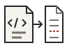
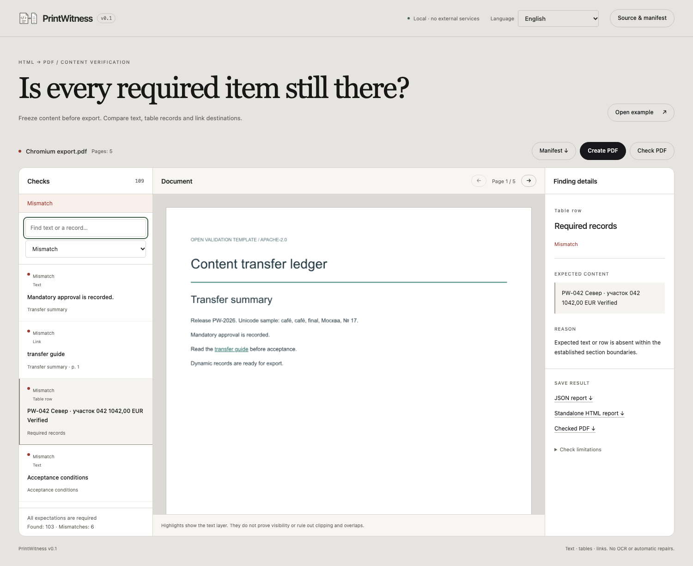

<p align="center">
  
</p>

# PrintWitness

[](https://github.com/0then0/PrintWitness/actions/workflows/ci.yml)
[](LICENSE)

Check whether required HTML text, table records and link destinations survive a PDF export. Freeze the expectations before printing, then compare a Chromium export or an existing text PDF with the same portable manifest.

PrintWitness runs locally. Its workspace combines a checklist, rendered document pages and finding details. Reports export as JSON or standalone HTML with embedded page previews.



**A text-layer match does not prove that content is visible.** Clipping, overlays, transparency and white-on-white text are not universally detected. Inspect the rendered pages before accepting the layout.

## Install

Use Node.js **24.13 or newer** and npm. Run these commands from the project directory:

```sh
npm ci
npm run browsers
npm run build
npm start
```

Open [127.0.0.1:4173](http://127.0.0.1:4173). On Linux, install Chromium's system dependencies with `npm run browsers -- --with-deps`; this may require administrator privileges. Browser binaries and npm cache default to the ignored `.local-browsers/` and `.npm-cache/` directories. `PLAYWRIGHT_BROWSERS_PATH` can override the browser location.

For development use `npm run dev`. Set `PORT` to change the local server port.

## Quickstart

1. Click **Open example**, or enter an absolute HTML path or localhost URL.
2. Enter CSS selectors for the required sections or tables. The example uses `#summary`, `#register` and `#terms`.
3. Choose how to wait for the page. For asynchronous data, use an explicit selector or global readiness signal with a bounded timeout.
4. Set intentional exclusions, then click **Freeze manifest**. Review the expectations and download the manifest.
5. Click **Create PDF**, or use **Check PDF** to select an existing text PDF. Both operations check against the frozen expectations.
6. Select a finding to inspect its explanation and page coordinates. Export the JSON report, standalone HTML report and checked PDF.

Capturing again creates a new baseline. Printing never silently replaces it. Keep the manifest, PDF and report together.

English is the default language. Spanish, German, French, Japanese, Brazilian Portuguese and Russian are also available. Interface text and HTML reports follow the selection; original content, URLs and machine-readable JSON remain unchanged.

See the [usage guide](docs/usage.md) for selectors, readiness, exclusions and report states, and the [matching reference](docs/matching.md) for the manifest contract and confidence limits.

## Example report

The open [validation template](fixtures/validation.html) contains a long table with 96 records, repeated headings and mandatory text, Unicode content, a link and an asynchronous readiness signal. It has no external assets and is covered by this repository's Apache-2.0 license.

```sh
npm run validate
```

Open `artifacts/validation/broken.html` or `fixed.html` directly in a browser. The reports embed all page previews and work offline.
- The broken export has six confirmed mismatches: a missing row, one missing repetition, a hidden section with three expectations, and an altered link destination.
- The fixed export finds all 109 expectations against the **same manifest**.

A missing-row finding contains the expected record and its established context:

```json
{
  "kind": "row",
  "expected": "PW-042 Север · участок 042 1042,00 EUR Verified",
  "status": "mismatch",
  "reason": "Expected text/row is absent inside the established section boundaries.",
  "evidence": []
}
```

## Validation and development

```sh
npm run check
```

This runs Biome, strict TypeScript checking, the production build, core regression tests, real Chromium/PDF.js validation and browser interaction tests. Browser tests cover every supported language at desktop, tablet and narrow mobile widths. [Reproducible validation](docs/validation.md) describes the assertions and generated artifacts.

[CI](.github/workflows/ci.yml) runs the same checks on Ubuntu with Node.js 24 for pushes and pull requests. See [CONTRIBUTING.md](CONTRIBUTING.md) for the code layout, formatting and translation workflow.

## Limits and privacy

PrintWitness v0.1 supports text PDFs, mandatory DOM text, ordinary table rows and URL annotations. It does not provide OCR, AI analysis, automatic layout repair, PDF/A validation, accounts or a hosted service.

The server binds to loopback. Source files are read without modification, and source content is not sent to external services. Dynamic source scripts execute in a disposable Chromium context with restricted networking. Remote assets must be made local first. Use trusted local documents; see the [security model](SECURITY.md) for the exact boundary.

Ambiguous section boundaries, wrapped or merged table cells, combined link-label items, unusual reading order and unsupported text layouts require manual review. The limits are 25 MiB per PDF, 100 PDF pages, 100 selected sections and 10,000 expectations. Reports contain document content and should be handled with the same care as their sources.

## Dependency maintenance

[Dependabot](.github/dependabot.yml) checks npm and GitHub Actions monthly. Minor and patch version updates are grouped per ecosystem; major updates remain separate. Each ecosystem has one scheduled PR slot, for a combined maximum of two. Automerge is not configured. Security updates are separate from those groups and limits; repository administrators must keep Dependabot alerts and security updates enabled.

## License

[Apache-2.0](LICENSE), including the SVG icon and validation template.
